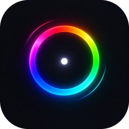

<p align="center">
  
</p>

<h1 align="center">Lwnny</h1>

<p align="center">One RGB controller for your whole PC. No vendor apps.</p>

Lwnny talks to the hardware directly (USB HID, GPU I2C, chipset SMBus),
shows every zone in one window, and lives in the tray. 10 MB, ~35 MB RAM,
near-zero CPU.

## Supported hardware

| Device | How | Survives reboot |
| --- | --- | --- |
| Lian Li UNI HUB SL-Infinity | USB | while powered |
| Lian Li Strimer Plus (24-pin, GPU) | USB | no |
| ASUS Aura motherboards (X570, both ARGB headers) | USB | yes |
| ASUS ROG Strix RTX 30-series | NvAPI I2C | yes |
| Corsair Vengeance RGB Pro / Dominator / DDR5 RAM | SMBus via PawnIO | yes |
| HyperX QuadCast S | USB | yes |

NZXT Kraken is left to NZXT CAM on purpose, so pump and fan curves stay put.

## Features

- Everything, per-device or per-zone colors, brightness, quick swatches.
- Rename zones; **Find** flashes a zone so you know which one it is.
- Profiles. **Save to hardware** so colors are right before Windows boots.
- **Own color** locks a device out of "Everything".
- Color correction wizard for LEDs that are off from the factory.
- Tray, close-to-tray, start with Windows, last lighting restored on launch.

Static colors only for now. Effects are next.

## RAM needs admin

RAM sits on the SMBus, which only a kernel driver can reach. Install
[PawnIO](https://pawnio.eu) once; Lwnny bundles the signed SMBus module and
asks for administrator rights at start. Decline and everything but the RAM
still works. Writes go through the system SMBus mutex and happen once per
color change, after it settles, so the sticks' flash is not worn.

## Build

Rust (MSVC), Node.js, VC++ Build Tools, WebView2.

```powershell
npm install
npm run dev      # hot reload
npm run build    # installer in src-tauri/target/release/bundle
```

Command-line diagnostics: `cargo run --bin probe -- list` in `src-tauri`
(`set`, `zone`, `hubmap`, `bench`, `rambench`). `cargo test` runs the unit
tests. Settings live in `%APPDATA%\Lwnny`.

## License

GPL-2.0-or-later. Device protocols were learned from
[OpenRGB](https://openrgb.org). SMBus access uses
[PawnIO](https://pawnio.eu) by namazso (module LGPL-2.1, in `src-tauri/pawnio/`).
